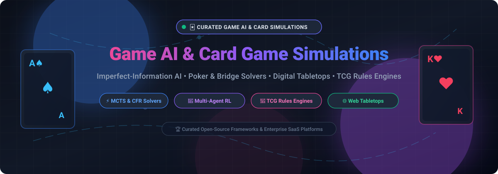

# 🃏 Awesome Game AI & Card Game Simulations

  

  
  
  
  
  

---

## 🌟 Overview & Highlights

A curated directory and research guide to **Game AI**, **Imperfect-Information Game Solvers**, **Card Game Simulation Suites**, **TCG Rules Engines**, and **Virtual Tabletop SaaS Platforms**. 

Whether you are developing multi-agent reinforcement learning (MARL) algorithms, training Counterfactual Regret Minimization (CFR) models, designing double-dummy Contract Bridge or Texas Hold'em Poker solvers, building custom Trading Card Game (TCG/CCG) clients, or hosting virtual card games, this repository tracks both leading **commercial cloud services** and battle-tested **open-source GitHub frameworks**.

### 🔍 Key Focus Areas:
- 🧠 **Imperfect-Information Game AI**: Counterfactual Regret Minimization (CFR/CFR+), Monte Carlo Tree Search (MCTS), Deep Reinforcement Learning (Deep CFR, Actor-Critic).
- ♠️ **Poker & Bridge Solvers**: Double-Dummy Solvers (DDS), equilibrium solvers, subgame solving, and hand analyzers.
- 🎴 **TCG Rules Engines & Playtesting**: Complete rules implementations for Magic: The Gathering, Yu-Gi-Oh!, Pokémon TCG, and custom extensible card mechanics.
- 🌐 **Virtual Tabletops & Web Sandboxes**: Browser-based multiplayer board/card game environments with real-time state synchronization.
- 📊 **Deck Analytics & Market Intelligence**: Automated hypergeometric calculators, card collection databases, and pricing APIs.

---

## 📑 Table of Contents

- [📊 Sector Overview & Market Dynamics](#-sector-overview--market-dynamics)
- [☁️ SaaS/Hosted & Commercial Platforms](#️-saashosted--commercial-platforms)
- [💻 Open-Source GitHub Projects](#-open-source-github-projects)
- [📈 Star History](#-star-history)
- [🛠️ How to Contribute](#️-how-to-contribute)
- [💖 Support & Sponsorship](#-support--sponsorship)
- [⚠️ Disclaimer](#️-disclaimer)

---

## 📊 Sector Overview & Market Dynamics

The global Digital Board Games, Trading Card Game (TCG) Platforms & Game AI Simulation market is valued at approximately **$14.2B–$17.8B+ in 2026**, expanding at a ~13%–17% CAGR propelled by digital TCG ecosystems, multi-agent imperfect-information AI benchmarks, and browser-based tabletop gaming. The sector exhibits **moderate concentration with winner-take-most dynamics in physical/digital commerce and licensed tabletops** (anchored by eBay/TCGplayer, Asmodee/Board Game Arena, and Steam/Berserk Games), while remaining **highly fragmented across community web tabletops, deck utilities, and open-source Game AI research frameworks** (`DeepMind OpenSpiel`, `RLCard`, `boardgame.io`, `Cockatrice`, `DDS`).

---

## ☁️ SaaS/Hosted & Commercial Platforms

*Sorted descending by company valuation / revenue scale.*

| Platform | Description | Company Scale (Valuation / Revenue) | Starting Paid Tier | Free Tier / Trial Limit |
| :--- | :--- | :--- | :--- | :--- |
| **[TCGplayer Cloud (eBay)](https://tcgplayer.com)** | 🛍️ Premier trading card marketplace, real-time card pricing API, collection scanner, and Pro inventory management cloud for Magic, Pokémon, and Yu-Gi-Oh!. | **Acquired by eBay for $295M** (~$10.3B+ eBay annual revenue; ~$30B+ market cap) | **$8.99 / month** for TCGplayer Infinite subscription (or 2.5%+ Pro seller platform fees) | **Forever Free Consumer & Collection Account** (Unlimited price guide lookups, mobile card scanning, and collection tracking) |
| **[Board Game Arena (Asmodee)](https://boardgamearena.com)** | 🎲 World's largest browser-based digital board and card game platform featuring 1,000+ licensed games, rule enforcement, ELO rankings, and AI bots. | **Part of Asmodee Group** (Acquired for ~$15M–$25M; ~$1.4B+ Asmodee annual revenue) | **€3.00 / month** billed annually (€36/yr) or **€5.00 / month** monthly for BGA Premium | **Forever Free Basic Plan** (Unlimited play across hundreds of free games and joining any Premium-hosted table with ads/queue) |
| **[Tabletop Simulator Cloud (Berserk Games)](https://tabletopsimulator.com)** | 🕹️ Physics-driven 3D sandbox tabletop with Steam Cloud sync, Lua scripting, and 40,000+ Steam Workshop card and board game modules. | **~$45M–$90M Gross Revenue** (~$15M–$30M net; >3M copies sold on Steam) | **$19.99 one-time** Steam purchase (or $59.99 for a 4-pack license) | **No Perpetual Free Tier** (One-time purchase required per player; all 40,000+ Steam Workshop community card/board mods are free) |
| **[Moxfield](https://moxfield.com)** | 🃏 Fast, modern Magic: The Gathering deck-building, playtesting simulator, hypergeometric probability analyzer, and collection management SaaS. | **~$5M–$15M Est. Scale** (Bootstrapped flagship MTG deckbuilding platform) | **$1.00 / month** (Status Quo tier) or **$5.00 / month** (Improvements tier) | **Forever Free Full Platform** (Unlimited decks, interactive goldfishing playtester, EDHREC synergy stats, and collection tracking free) |
| **[Tabletopia](https://tabletopia.com)** | 🌐 Cross-platform digital sandbox arena for playing 2,500+ licensed board and card games in 3D browser/Steam environments with zero setup. | **~$5M–$10M Est. Scale** ($133K+ crowdfunded; 70/30 publisher revenue split) | **$4.99 / month** for Silver plan or **$9.99 / month** for Gold plan | **Forever Free Bronze Plan** (Access to 800+ free-to-play board/card games and up to **2 active concurrent game sessions**) |
| **[Cardhoarder Cloud](https://cardhoarder.com)** | 🤖 Automated bot-network trading, cloud collection management, and Magic Online (MTGO) deck rental subscription service. | **~$5M–$10M Est. Scale** (Leading MTGO secondary market & card rental network) | **$2.99 / week** (~$12/mo) for Loan Program starter tier (up to 100 tix card rental cap) | **Forever Free Cardkeeper & Loan Tier** (Free **5-ticket starter loan program** to play budget decks on MTGO + free collection tracker) |
| **[Deckbox](https://deckbox.org)** | 📦 Cloud-hosted trading card inventory manager, deck builder, price tracker, and peer-to-peer card trading marketplace. | **~$2M–$5M Est. Scale** (Profitable bootstrapped TCG community SaaS) | **$3.99 / month** billed annually ($47.88/yr) or **$5.99 / month** monthly for Deckbox Premium | **Forever Free Basic Account** (Unlimited card inventory tracking, deck building, and community trading with basic filters) |
| **[Untap.in](https://untap.in)** | 🎴 Browser-based system-agnostic TCG and custom card game tabletop simulator supporting Magic, Pokémon, Yu-Gi-Oh!, Lorcana, and custom decks. | **~$1M–$3M Est. Scale** (Independent community-funded web tabletop) | **$5.00 / month** for Power Up tier (unlocked 5–6 seat tables, deck vs deck testing, unlimited slots) | **Forever Free Plan** (Play unlimited browser TCG matches with up to 4 players and up to **10 active saved decks**) |
| **[PlayingCards.io](https://playingcards.io)** | 🎴 Zero-login, browser-based virtual tabletop for playing classic card games, custom decks, and board games over instant shareable room links. | **~$500K–$1.5M Est. Scale** (Independent indie web utility & SaaS) | **$5.00 / month** for Small Groups tier or **$8.00 / month** for Pro Host tier | **Forever Free Plan** (Unlimited instant custom card/board rooms, custom card importers; free rooms expire after **2 weeks** of inactivity, or **30 days** with free account) |
| **[Cockatrice Cloud (Public Servatrice Servers)](https://github.io)** | 🛡️ Hosted public multiplayer relay servers (`Rooster Ranges`, `Tetrarch`) connecting open-source Cockatrice clients for global TCG playtesting. | **Community-Funded Open Infrastructure** (~$100/mo server operating costs covered by donations) | **$10.00 / one-time donation** (Perks: bypass server player limits & disable idle timeouts) | **100% Free Forever** (Unlimited online multiplayer card matches, draft rooms, and replays with free account registration; standard idle timeout applies) |

---

## 💻 Open-Source GitHub Projects

*Sorted descending by GitHub stargazers count. Each repository includes a social badge linking to its stargazers page.*

| Repository | GitHub_Stars | Focus / Category | Description |
| :--- | :--- | :--- | :--- |
| **[boardgame.io](https://github.com/boardgameio/boardgame.io)** |  | 🌐 Web Tabletop & Game Engine | Open-source state management and game engine for turn-based board and card games with automatic multiplayer state sync and AI bots. |
| **[open_spiel](https://github.com/google-deepmind/open_spiel)** |  | 🧠 Multi-Agent RL & CFR | Google DeepMind's flagship collection of environments and algorithms for research in multi-agent reinforcement learning, CFR, and imperfect-information games (Poker, Bridge, Hearts, Hanabi). |
| **[rlcard](https://github.com/datamllab/rlcard)** |  | 🃏 Card Game RL Toolkit | PyTorch/TensorFlow reinforcement learning toolkit supporting Blackjack, Leduc Hold'em, Texas Hold'em, Mahjong, Dou Dizhu, UNO, and Gin Rummy. |
| **[forge](https://github.com/Card-Forge/forge)** |  | ⚔️ Rules Engine & MTG AI | Comprehensive rules engine and AI opponent suite for Magic: The Gathering supporting thousands of cards, quest modes, and draft simulations. |
| **[TexasSolver](https://github.com/bupticybee/TexasSolver)** |  | ♠️ Texas Hold'em Equilibrium | Fast, open-source C++ Texas Hold'em subgame solver and equilibrium optimizer using Discounted Counterfactual Regret Minimization (DCFR). |
| **[mage (XMage)](https://github.com/magefree/mage)** |  | 🎴 Full-Rules Multiplayer TCG | Java-based full-rules engine and online multiplayer client for Magic: The Gathering with automatic trigger resolution and phase mechanics. |
| **[Cockatrice](https://github.com/Cockatrice/Cockatrice)** |  | 🌐 Cross-Platform TCG Client | Cross-platform virtual tabletop designed specifically for tabletop card games (MTG, Pokémon, custom TCGs) over decentralized Servatrice servers. |
| **[poker_ai](https://github.com/fedden/poker_ai)** |  | 🤖 Deep RL Poker Agent | Deep reinforcement learning framework and OpenAI Gym environment for training heads-up Texas Hold'em agents using DQN and policy gradients. |
| **[bridgeplay](https://github.com/raymondchins/bridgeplay)** |  | 🃏 Bridge AI & Simulator | Open-source Contract Bridge cardplay simulator and AI engine designed for testing bidding conventions, cardplay strategies, and deal distributions. |
| **[hanabi-learning-environment](https://github.com/deepmind/hanabi-learning-environment)** |  | 🎆 Cooperative Imperfect AI | Google DeepMind's research benchmark environment for zero-shot coordination and cooperative imperfect-information card play in the card game Hanabi. |
| **[vassal](https://github.com/vassalengine/vassal)** |  | 🎲 Tabletop Game Engine | Mature open-source game engine for building and playing digital adaptations of board games and card games online in real time or via email (PBEM). |
| **[pokerkit](https://github.com/uoftcprg/pokerkit)** |  | ♠️ Poker Simulation & Hand Eval | University of Toronto's comprehensive Python library for poker game simulations, hand evaluation, state parsing, and game-theoretic benchmarking. |
| **[pycfr](https://github.com/tansey/pycfr)** |  | 🔬 Python CFR Algorithms | Python implementation of Counterfactual Regret Minimization algorithms for extensive-form and imperfect-information card games. |

---

## 📈 Star History

---

## 🛠️ How to Contribute

Contributions are warmly welcomed! 🤝

1. 🍴 Fork the repository.
2. 🌿 Create a new descriptive branch (`git checkout -b add-solver-name`).
3. 📝 Add your tool, platform, or framework with factual documentation, pricing/license terms, and official links.
4. 🚀 Push your branch and submit a Pull Request.

---

## 💖 Support & Sponsorship

Thank you for exploring and using this curated resource! If you find this directory valuable for your research, game engineering, or hobby projects, please consider supporting the project:

- ⭐ **Star this repository** on GitHub to help others discover it.
- 🍴 **Fork and share** the project with researchers, AI engineers, and card game enthusiasts.
- ☕ **Buy me a coffee / Sponsor**: If you'd like to support ongoing curation and development, please visit the [GitHub Sponsor Dashboard](https://github.com/sponsors/ishandutta2007).

Your support is deeply appreciated! 💖

---

## ⚠️ Disclaimer

All product names, trademarks, logos, and brands belong to their respective owners. Mention of SaaS products or commercial entities is for informational and educational curation purposes only and does not imply endorsement or official partnership.
